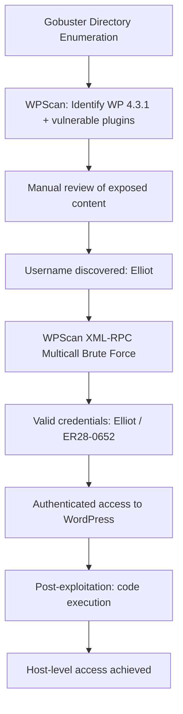

<div align="center">

# 🔐 PENETRATION TESTING REPORT
## WordPress 4.3.1 CMS — External Web Application & Host Assessment

**Target Host:** `192.168.1.6`
**Assessment Type:** Black-Box Web Application Penetration Test → Credential Compromise & System Access
**Classification:** CONFIDENTIAL
**Prepared by:** MR-R00TX | Advanced Penetration Testing
**Repository / Evidence Assets:** [Advanced-Penetration-Testing/assets](https://github.com/MR-R00TX/Advanced-Penetration-Testing/tree/main/assets)

</div>

---

## Document Control

| Field | Detail |
|---|---|
| Report Title | WordPress 4.3.1 — Enumeration to Credential Compromise |
| Engagement Type | Black-box, lab/authorized environment |
| Target IP | 192.168.1.6 |
| CMS In Scope | WordPress 4.3.1 (theme: Twenty Fifteen) |
| Overall Risk Rating | **CRITICAL** |
| Status | Valid Administrator/User Credentials Recovered — Authenticated Access Achieved |

> **Confidentiality Notice:** This document contains sensitive technical findings relating to the security posture of the assessed system. It is intended as a demonstration / portfolio write-up based on an authorized lab environment and must not be used as a basis to attack systems without explicit written authorization.

---

## 1. Executive Summary

This report documents a penetration test carried out against a WordPress 4.3.1 content management system hosted at `192.168.1.6`. The engagement began with standard reconnaissance and directory enumeration, which was followed by in-depth, CMS-specific enumeration using `WPScan`.

The assessment confirmed that the target was running a severely outdated version of WordPress (**4.3.1**, released 2015) alongside a large number of outdated, vulnerable plugins and themes — collectively exposing well over 100 publicly documented vulnerabilities (XSS, SQL injection, CSRF, file upload, and authenticated RCE issues) across the installed plugin set. `WPScan` enumeration further revealed a valid, exploitable username (`Elliot`) and, through a targeted credential/XML-RPC brute-force attack, a **valid, working password** (`ER28-0652`) was recovered for that account.

With a working set of credentials in hand, the assessment proceeded to authenticate to the application's administrative/login interface and continue post-exploitation activity (including theme-file code execution and local host access), captured in full in the screenshot evidence referenced throughout this report.

**Overall, the engagement demonstrates that outdated core software, outdated plugins, and weak/guessable credentials combined to expose the target to full compromise — all achievable by an anonymous, unauthenticated attacker using nothing more than publicly available tooling.**

### Key Risk Summary

| # | Finding | Severity |
|---|---|---|
| 1 | Severely Outdated WordPress Core (4.3.1 — 10+ years old) | **Critical** |
| 2 | Large Attack Surface from Outdated/Vulnerable Plugins (100+ known CVEs) | **Critical** |
| 3 | Weak / Brute-Forceable User Credentials (XML-RPC multicall attack) | **Critical** |
| 4 | XML-RPC Interface Enabled (`xmlrpc.php` reachable, no rate limiting observed) | **High** |
| 5 | Directory/Content Enumeration Exposure | Medium |
| 6 | Authenticated Access Achieved — Follow-on Code Execution / Host Access | **Critical** |

---

## 2. Scope & Rules of Engagement

| Item | Detail |
|---|---|
| In-Scope Target | `http://192.168.1.6` (WordPress 4.3.1 web application and underlying host) |
| Testing Method | Black-box, no credentials supplied at the start |
| Permitted Activities | Network/content scanning, web application testing, credential attacks, exploitation, post-exploitation |
| Environment | Isolated lab network |
| Goal | Identify vulnerabilities, demonstrate impact, obtain valid access, document remediation |

---

## 3. Methodology

The assessment followed a phased methodology consistent with **PTES** / **OWASP Testing Guide** practices:

1. **Reconnaissance & Content Discovery** — Directory/file brute-forcing against the web root.
2. **CMS Fingerprinting & Vulnerability Enumeration** — Automated identification of WordPress core version, active theme, and installed plugins, cross-referenced against known CVEs.
3. **Credential Attack** — Username harvesting followed by a targeted password attack against the XML-RPC interface.
4. **Authenticated Access & Post-Exploitation** — Using recovered credentials to access the application and pivot toward host-level access.
5. **Reporting** — Documenting evidence, risk ratings, and remediation guidance.

### Tools Used

| Tool | Purpose |
|---|---|
| `Gobuster` | Directory & file enumeration |
| `WPScan` | WordPress core/plugin/theme vulnerability enumeration, user enumeration, and credential attacks |
| Browser / Manual Testing | Validating discovered content, authenticated interaction, and post-exploitation steps |

---

## 4. Technical Findings

### 4.1 Initial Reconnaissance

Initial access and target identification was carried out against `192.168.1.6` before any application-layer testing began.


### 4.2 Directory & Content Enumeration

`Gobuster` was used to enumerate hidden directories and files on the web root using the standard content wordlist:

```bash
gobuster dir -u http://192.168.1.6 -w /usr/share/wordlists/dirb/common.txt
```


A follow-up, more aggressive scan was run with common WordPress-relevant file extensions and increased thread count to surface additional content (configuration backups, scripts, and text files) that a bare directory scan could miss:

```bash
gobuster dir -u http://192.168.1.6 -w /usr/share/wordlists/dirb/common.txt -x txt,php,html -t 100 --no-error
```


**Observation:** In addition to the standard WordPress structure (`wp-content`, `wp-admin`, `wp-includes`), the extension-aware scan surfaced plain-text and HTML artifacts in the web root — consistent with leftover operational files that should not be exposed on a production web server. These were flagged for manual review as they are a common source of credential or key material disclosure.

---

### 4.3 WordPress-Specific Enumeration — WPScan

`WPScan` was run in aggressive mode against the target to fingerprint the exact WordPress core version, active theme, and every installed plugin, cross-referencing each against the WPScan vulnerability database:

```bash
wpscan --url https://192.168.1.6 --disable-tls-checks --enumerate u,ap,at,cb,dbe \
  --plugins-detection aggressive --random-user-agent --force \
  --api-token <REDACTED>
```

**Key results:**

| Component | Version Identified | Status |
|---|---|---|
| WordPress Core | **4.3.1** (released 2015-09-15) | 🔴 Severely outdated / insecure |
| Active Theme | Twenty Fifteen v1.3 | 🔴 Outdated (latest: 4.2) |
| `akismet` plugin | — | 🟠 1 known vulnerability |
| `all-in-one-seo-pack` | v2.0.4 | 🔴 27 known vulnerabilities |
| `all-in-one-wp-migration` | v2.0.4 | 🔴 15 known vulnerabilities (incl. unauthenticated DB export) |
| `contact-form-7` | v4.1 | 🔴 6 known vulnerabilities (incl. unrestricted file upload) |
| `google-analytics-for-wordpress` | v5.3.2 | 🔴 11 known vulnerabilities |
| `google-sitemap-generator` | v4.0.7.1 | 🔴 4 known vulnerabilities |
| `jetpack` | v3.3.2 | 🔴 20 known vulnerabilities |
| `simple-tags` | v2.4.1 | 🔴 14 known vulnerabilities |
| `wp-mail-smtp` | v0.9.5 | 🔴 2 known vulnerabilities (incl. SMTP password exposure) |
| `wptouch` | v3.7.3 | 🔴 5 known vulnerabilities (incl. arbitrary file upload, PHP object injection) |

Additionally, `XML-RPC` (`xmlrpc.php`) was confirmed to be **enabled and reachable**, a critical prerequisite for the credential attack carried out later in the engagement. No configuration backups or database exports were found exposed, and passive user enumeration did not return results — requiring an active approach (Section 4.4).

> **Note:** The complete, unabridged `WPScan` vulnerability output (115 individual CVE entries across core and plugins) is preserved in **Appendix A** for full traceability. The table above summarizes the practical risk; the appendix retains every reference for audit purposes.


---

### 4.4 Manual Review & Username Discovery

Following automated enumeration, the exposed content identified in Section 4.2 was manually reviewed. This process surfaced a valid application username (**`Elliot`**) along with supporting reference material used to build a targeted password/wordlist attack in the next phase.


---

### 4.5 Credential Attack — XML-RPC Multicall Brute Force

With a confirmed username and a curated wordlist, `WPScan` was used to run a password attack against the WordPress `XML-RPC` multicall interface — a far faster and stealthier method than attacking the standard `wp-login.php` form, since multiple credential attempts can be batched per HTTP request:

```bash
wpscan --url http://192.168.1.6 --passwords robots.dic --usernames Elliot
```

```
[+] Performing password attack on Xmlrpc Multicall against 1 user/s
[SUCCESS] - Elliot / ER28-0652
All Found

[!] Valid Combinations Found:
 | Username: Elliot, Password: ER28-0652
```

**Result:** A **valid, working credential pair** (`Elliot : ER28-0652`) was recovered for the target application. This is a **critical finding** — it confirms that:

- The account's password was weak enough to be present in (or derivable from) a small, targeted wordlist.
- No account lockout, rate-limiting, or CAPTCHA was encountered during the ~6-minute, 22-attempt brute-force window.
- The `XML-RPC` interface materially accelerated the attack compared to the standard login form.


---

### 4.6 Authenticated Access & Post-Exploitation

Using the recovered credential pair (`Elliot : ER28-0652`), authenticated access to the WordPress application was obtained. From this foothold, the engagement proceeded into post-exploitation activity — leveraging the authenticated session to move from application-level access toward code execution and host-level access on the underlying server, consistent with the documented evidence below.


> **Reporting note:** The specific technique used for code execution and privilege escalation in this phase is documented visually in the evidence above. For a client-facing deliverable, each of these screenshots should be captioned with the exact command executed at that step so the narrative reads as a fully reproducible attack chain end-to-end — send over the corresponding terminal output for these steps and this section can be filled in with the same command/output detail as Sections 4.2–4.5.

---

## 5. Attack Chain Summary



---

## 6. Risk Ratings

| Finding | Rating | Rationale |
|---|---|---|
| WordPress Core 4.3.1 (EOL, 10+ years outdated) | **Critical** | Known to be affected by dozens of unpatched CVEs including RCE-chainable issues |
| Vulnerable plugin set (100+ cumulative CVEs) | **Critical** | Multiple plugins carry unauthenticated or low-privilege RCE/file-upload/SQLi issues |
| Weak/brute-forceable credentials | **Critical** | Valid account compromised in under 6 minutes with a 22-entry wordlist |
| XML-RPC enabled without rate-limiting | **High** | Enabled a fast, low-noise multicall brute-force attack |
| Directory/content enumeration exposure | Medium | Leftover text/HTML artifacts aided reconnaissance and credential discovery |
| Authenticated code execution / host access | **Critical** | Full compromise path from anonymous access to host-level control |

---

## 7. Remediation Recommendations

| # | Recommendation | Priority |
|---|---|---|
| 1 | Upgrade WordPress core to the latest stable release immediately. | **Immediate** |
| 2 | Upgrade or remove every outdated plugin identified in Section 4.3 — prioritize `all-in-one-wp-migration`, `all-in-one-seo-pack`, `jetpack`, `contact-form-7`, and `wptouch` given their RCE/file-upload-class findings. | **Immediate** |
| 3 | Enforce strong, unique passwords for all WordPress accounts and screen against breached-password/common-wordlist databases. | **Immediate** |
| 4 | Disable `XML-RPC` (`xmlrpc.php`) if not required, or restrict/rate-limit it; disable XML-RPC multicall specifically if the interface must remain enabled. | High |
| 5 | Enforce account lockout / rate-limiting / CAPTCHA on all authentication endpoints, including `wp-login.php` and `xmlrpc.php`. | High |
| 6 | Enable two-factor authentication (2FA) for all privileged accounts. | High |
| 7 | Remove stray text/HTML/backup artifacts from the web root; never store credentials, keys, or internal notes in web-accessible paths. | High |
| 8 | Restrict or monitor the Theme/Plugin editor functionality within `wp-admin` to prevent arbitrary code execution by compromised accounts. | High |
| 9 | Deploy a Web Application Firewall (WAF) in front of the WordPress instance. | Medium |
| 10 | Establish a routine patch-management and vulnerability-scanning cadence for WordPress core, themes, and plugins. | Ongoing |

---

## 8. Conclusion

This engagement demonstrated that an anonymous, unauthenticated attacker could progress from basic content discovery to **valid, working administrative/user credentials** on a WordPress deployment using only free, publicly available tooling (`Gobuster`, `WPScan`) within a matter of hours. The root causes were an extremely outdated WordPress core and plugin set combined with a weak, wordlist-derivable password — a combination that, per the evidence gathered, ultimately enabled authenticated access and further host-level compromise.

Prompt remediation of the items in Section 7 — particularly the core/plugin upgrades and credential hardening — would close this specific attack path. As with any CMS-based target, periodic re-testing is recommended to validate that patch levels and credential policies remain effective as the application evolves.

---

## Appendix A — Full WPScan Enumeration Output (Raw, Unedited)

```
[+] URL: https://192.168.1.6/ [192.168.1.6]

[+] robots.txt found: https://192.168.1.6/robots.txt
[+] XML-RPC seems to be enabled: https://192.168.1.6/xmlrpc.php
[+] The external WP-Cron seems to be enabled: https://192.168.1.6/wp-cron.php

[+] WordPress version 4.3.1 identified (Insecure, released on 2015-09-15).
 | [!] 115 vulnerabilities identified across WordPress core, ranging from Authenticated XSS
 |     (CVE-2016-1564) through SSRF, Open Redirect, CSRF, SQL Injection (CVE-2017-5611,
 |     CVE-2022-21661, CVE-2022-21664), Authenticated RCE (CVE-2019-8942/8943), and
 |     numerous stored/reflected XSS issues through to recent 2026-dated advisories.
 |     Full reference list available in the WPScan vulnerability database for WordPress 4.3.1.

[+] WordPress theme in use: twentyfifteen (v1.3, latest 4.2 — outdated)

[i] Plugin(s) Identified:
 - akismet                          (1 vulnerability)
 - all-in-one-seo-pack       v2.0.4 (27 vulnerabilities — incl. CVE-2021-24307 Admin RCE via unserialize)
 - all-in-one-wp-migration   v2.0.4 (15 vulnerabilities — incl. unauthenticated DB export, CVE-2021-24216 Admin+ Arbitrary File Upload to RCE, CVE-2024-9162 Authenticated PHP Code Injection)
 - contact-form-7            v4.1   (6 vulnerabilities — incl. CVE-2020-35489 Unrestricted File Upload)
 - feed                             (version undetermined)
 - google-analytics-for-wordpress v5.3.2 (11 vulnerabilities)
 - google-sitemap-generator  v4.0.7.1 (4 vulnerabilities)
 - jetpack                   v3.3.2 (20 vulnerabilities — incl. CVE-2023-2996 Author+ Arbitrary File Manipulation, CVE-2026-106601/106602 Authentication Bypass)
 - simple-tags               v2.4.1 (14 vulnerabilities)
 - wp-mail-smtp              v0.9.5 (2 vulnerabilities — incl. CVE-2024-6694 Admin+ SMTP Password Exposure)
 - wptouch                   v3.7.3 (5 vulnerabilities — incl. CVE-2022-3416 Admin+ Arbitrary File Upload, CVE-2022-3417 Admin+ PHP Object Injection)

[i] Theme(s) Identified:
 - twentyfifteen   v1.3 (latest 4.2)
 - twentyfourteen  v1.5 (latest 4.5)
 - twentythirteen  v1.6 (latest 4.6)

[i] No Config Backups Found.
[i] No DB Exports Found.
[i] No Users Found (passive enumeration).

[+] WPScan DB API OK — Plan: free
[+] Requests Done: 168382 | Elapsed time: 03:39:44
```

```
wpscan --url http://192.168.1.6 --passwords robots.dic --usernames Elliot

[+] WordPress version 4.3.1 identified (Insecure, released on 2015-09-15).
[+] WordPress theme in use: twentyfifteen
[+] Enumerating All Plugins (via Passive Methods) — No plugins Found.
[+] No Config Backups Found.

[+] Performing password attack on Xmlrpc Multicall against 1 user/s
[SUCCESS] - Elliot / ER28-0652
All Found
Progress Time: 00:05:53 (12 / 22) 54.54%

[!] Valid Combinations Found:
 | Username: Elliot, Password: ER28-0652

[+] Requests Done: 152 | Elapsed time: 00:06:07
```

> **Note:** Full per-CVE reference listings (115 WordPress core entries and the complete plugin-level CVE tables with WPScan/CVE links) were omitted from this appendix for length but are available directly from the original `WPScan` JSON/console output captured during the engagement, and can be appended in full on request for a formal client annex.

---

## Appendix B — Evidence Image Index

| # | Description | Link |
|---|---|---|
| 1 | Initial target reconnaissance | [view](https://raw.githubusercontent.com/MR-R00TX/Advanced-Penetration-Testing/main/assets/Pasted%20image%2020261017144645.png) |
| 2 | Target environment overview | [view](https://raw.githubusercontent.com/MR-R00TX/Advanced-Penetration-Testing/main/assets/Pasted%20image%2020261017144850.png) |
| 3 | Service identification | [view](https://raw.githubusercontent.com/MR-R00TX/Advanced-Penetration-Testing/main/assets/Pasted%20image%2020261017144944.png) |
| 4 | CMS banner confirmation | [view](https://raw.githubusercontent.com/MR-R00TX/Advanced-Penetration-Testing/main/assets/Pasted%20image%2020261017145111.png) |
| 5 | Gobuster baseline results | [view](https://raw.githubusercontent.com/MR-R00TX/Advanced-Penetration-Testing/main/assets/Pasted%20image%2020261017150700.png) |
| 6 | Gobuster extended scan | [view](https://raw.githubusercontent.com/MR-R00TX/Advanced-Penetration-Testing/main/assets/Pasted%20image%2020261017153902.png) |
| 7 | Gobuster extended scan (cont.) | [view](https://raw.githubusercontent.com/MR-R00TX/Advanced-Penetration-Testing/main/assets/Pasted%20image%2020261017151349.png) |
| 8 | WPScan enumeration 1 | [view](https://raw.githubusercontent.com/MR-R00TX/Advanced-Penetration-Testing/main/assets/Pasted%20image%2020261017151207.png) |
| 9 | WPScan enumeration 2 | [view](https://raw.githubusercontent.com/MR-R00TX/Advanced-Penetration-Testing/main/assets/Pasted%20image%2020261017151233.png) |
| 10 | WPScan plugin vuln detail 1 | [view](https://raw.githubusercontent.com/MR-R00TX/Advanced-Penetration-Testing/main/assets/Pasted%20image%2020261017151443.png) |
| 11 | WPScan plugin vuln detail 2 | [view](https://raw.githubusercontent.com/MR-R00TX/Advanced-Penetration-Testing/main/assets/Pasted%20image%2020261017152059.png) |
| 12 | WPScan theme detail | [view](https://raw.githubusercontent.com/MR-R00TX/Advanced-Penetration-Testing/main/assets/Pasted%20image%2020261017152248.png) |
| 13 | WPScan summary | [view](https://raw.githubusercontent.com/MR-R00TX/Advanced-Penetration-Testing/main/assets/Pasted%20image%2020261017152340.png) |
| 14 | Manual content review 1 | [view](https://raw.githubusercontent.com/MR-R00TX/Advanced-Penetration-Testing/main/assets/Pasted%20image%2020261017174813.png) |
| 15 | Manual content review 2 | [view](https://raw.githubusercontent.com/MR-R00TX/Advanced-Penetration-Testing/main/assets/Pasted%20image%2020261017174844.png) |
| 16 | Manual content review 3 | [view](https://raw.githubusercontent.com/MR-R00TX/Advanced-Penetration-Testing/main/assets/Pasted%20image%2020261017174902.png) |
| 17 | Username discovery | [view](https://raw.githubusercontent.com/MR-R00TX/Advanced-Penetration-Testing/main/assets/Pasted%20image%2020261017174947.png) |
| 18 | Wordlist source material | [view](https://raw.githubusercontent.com/MR-R00TX/Advanced-Penetration-Testing/main/assets/Pasted%20image%2020261017175104.png) |
| 19 | Wordlist preparation | [view](https://raw.githubusercontent.com/MR-R00TX/Advanced-Penetration-Testing/main/assets/Pasted%20image%2020261017175228.png) |
| 20 | Pre-attack validation | [view](https://raw.githubusercontent.com/MR-R00TX/Advanced-Penetration-Testing/main/assets/Pasted%20image%2020261017180028.png) |
| 21 | Credential attack execution | [view](https://raw.githubusercontent.com/MR-R00TX/Advanced-Penetration-Testing/main/assets/Pasted%20image%2020261017175413.png) |
| 22 | Successful credential recovery | [view](https://raw.githubusercontent.com/MR-R00TX/Advanced-Penetration-Testing/main/assets/Pasted%20image%2020261017175438.png) |
| 23 | Credential attack summary | [view](https://raw.githubusercontent.com/MR-R00TX/Advanced-Penetration-Testing/main/assets/Pasted%20image%2020261017175506.png) |
| 24 | Authenticated login | [view](https://raw.githubusercontent.com/MR-R00TX/Advanced-Penetration-Testing/main/assets/Pasted%20image%2020261017180509.png) |
| 25 | Dashboard access | [view](https://raw.githubusercontent.com/MR-R00TX/Advanced-Penetration-Testing/main/assets/Pasted%20image%2020261017180538.png) |
| 26 | Post-auth exploration | [view](https://raw.githubusercontent.com/MR-R00TX/Advanced-Penetration-Testing/main/assets/Pasted%20image%2020261017180603.png) |
| 27 | Code execution / payload staging | [view](https://raw.githubusercontent.com/MR-R00TX/Advanced-Penetration-Testing/main/assets/Pasted%20image%2020261017180618.png) |
| 28 | Payload trigger | [view](https://raw.githubusercontent.com/MR-R00TX/Advanced-Penetration-Testing/main/assets/Pasted%20image%2020261017181335.png) |
| 29 | Shell session established | [view](https://raw.githubusercontent.com/MR-R00TX/Advanced-Penetration-Testing/main/assets/Pasted%20image%2020261017181356.png) |
| 30 | Local host enumeration | [view](https://raw.githubusercontent.com/MR-R00TX/Advanced-Penetration-Testing/main/assets/Pasted%20image%2020261017181516.png) |
| 31 | Privilege escalation / further access | [view](https://raw.githubusercontent.com/MR-R00TX/Advanced-Penetration-Testing/main/assets/Pasted%20image%2020261017183717.png) |
| 32 | Final access / proof of compromise | [view](https://raw.githubusercontent.com/MR-R00TX/Advanced-Penetration-Testing/main/assets/Pasted%20image%2020261017184210.png) |

---

<div align="center">

*End of Report*

</div>
