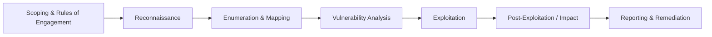

<div align="center">

# 🛡️ Advanced Penetration Testing

**Offensive security notes, methodologies, tooling and lab write-ups**


</div>

---

## 📖 About This Repository

This repository is my working portfolio as an aspiring professional penetration tester. It documents how I approach security assessments: from reconnaissance and enumeration, through exploitation, to **clear, actionable reporting**.

All testing is performed **exclusively in isolated virtual labs I own and control**, on intentionally vulnerable applications, and on authorized CTF / training platforms. Nothing here targets real systems without permission.

**What you'll find here**

- 📘 Structured methodologies aligned with industry standards
- 🧪 Lab write-ups with reproducible steps, evidence and remediation advice
- 🧰 Custom automation scripts (Python / Bash) for recon and workflow efficiency
- 🗒️ Cheat sheets and quick references from my day-to-day testing

---

## 🎯 Areas of Focus

| Domain | Coverage |
|---|---|
| **Web Application Pentesting** | OWASP Top 10, authentication & session flaws, access control, injection, XSS, file upload, business logic |
| **WordPress / CMS Security** | Plugin & theme review, misconfiguration, user enumeration, hardening |
| **Network Assessment** | Host discovery, service enumeration, vulnerability validation |
| **OSINT & Recon** | Subdomain discovery, attack-surface mapping, exposure analysis |
| **Reporting** | Severity rating (CVSS), proof of concept, remediation guidance |

---

## 🧪 Lab Environment

All practical work is done in a segmented, host-only virtual lab so that nothing touches real networks.

```
┌──────────────────────── Host Machine ────────────────────────┐
│                                                              │
│   ┌─────────────┐      Host-only / NAT network      ┌─────────────────────┐
│   │  Kali Linux │ ◄──────────────────────────────►  │  Vulnerable Targets │
│   │  (Attacker) │                                   │  (Isolated VMs)     │
│   └─────────────┘                                   └─────────────────────┘
│                                                              │
└──────────────────────────────────────────────────────────────┘
```

**Virtualization:** VirtualBox / VMware  **Attacker OS:** Kali Linux

### Target Practice Platforms

| Target | Source | Focus | Status |
|---|---|---|---|
| **VulnOS 2** | VulnHub | Web app exploitation → privilege escalation | 🔲 Planned |
| **Metasploitable 2** | Rapid7 | Network / service enumeration & exploitation | 🔲 Planned |
| **Kioptrix Level 1** | VulnHub | Classic legacy-service exploitation | 🔲 Planned |
| **Mr-Robot: 1** | VulnHub | WordPress enumeration → privilege escalation | 🔲 Planned |
| **DC-2** | VulnHub | WordPress enumeration → password cracking → privilege escalation | 🔲 Planned |
| **DC-3** | VulnHub | CMS (Joomla) exploitation → privilege escalation | 🔲 Planned |
| **DC-6** | VulnHub | WordPress exploitation → privilege escalation | 🔲 Planned |
| **Empire: Lupin One** | VulnHub | Web enumeration → credential attacks → privilege escalation | 🔲 Planned |
| **Matrix-Breakout 2: Morpheus** | VulnHub | Web enumeration → exploitation → privilege escalation | 🔲 Planned |
| **DVWA** | OWASP-style practice app | Web vulnerabilities (SQLi, XSS, etc.) | 🔲 Planned |
| **OWASP Juice Shop** | OWASP | Modern JS web app | 🔲 Planned |

> Status legend: ✅ Completed · 🔄 In progress · 🔲 Planned

---

## 🛠️ Tools & Arsenal

| Category | Tools |
|---|---|
| **Reconnaissance & OSINT** | `Subfinder` · `Hakrawler` · `httpx` |
| **Scanning & Vulnerability Assessment** | `Nmap` · `Rustscan` · `Nuclei` |
| **Web Exploitation** | `Burp Suite` · `SQLmap` · `Gobuster` |
| **Scripting & Automation** | `Python` · `Bash` |

---

## 🧭 Methodology

My assessments follow a repeatable workflow, mapped to recognized frameworks (**OWASP WSTG**, **PTES**, **MITRE ATT&CK**):



1. **Scoping** – define targets, boundaries and authorization.
2. **Reconnaissance** – passive and active information gathering.
3. **Enumeration** – services, endpoints, parameters, technologies.
4. **Vulnerability Analysis** – manual testing backed by automated scanning.
5. **Exploitation** – safe, controlled proof of concept.
6. **Reporting** – impact, evidence, CVSS rating and fixes.

---

## 📂 Repository Structure

```
Advanced-Penetration-Testing/
├── Methodologies/   # Step-by-step guides per attack vector
├── Scripts/         # Custom recon & automation scripts
├── Notes/           # Cheat sheets, command references
├── Writeups/        # Lab & CTF assessment reports
└── README.md
```

---

## 📝 Featured Write-ups

Each write-up follows a professional report format. Entries are added as I complete each lab.

| # | Target | Vulnerability Class | Severity | Report |
|---|---|---|---|---|
| 01 | _VulnOS 2_ | _Web app exploitation & privilege escalation_ | _—_ | _Coming soon_ |
| 02 | _Metasploitable 2_ | _Service enumeration & exploitation_ | _—_ | _Coming soon_ |
| 03 | _Kioptrix Level 1_ | _Legacy service exploitation_ | _—_ | _Coming soon_ |
| 04 | _Mr-Robot: 1_ | _WordPress enumeration & privilege escalation_ | _—_ | _[View Report](https://github.com/MR-R00TX/Advanced-Penetration-Testing/tree/main/Mr-Robot-Red-Team-Operations)_ |
| 05 | _DC-2_ | _WordPress exploitation & privilege escalation_ | _—_ | _[[View Report]](https://github.com/MR-R00TX/Advanced-Penetration-Testing/tree/main/Mr-Robot-Red-Team-Operations)(https://github.com/MR-R00TX/Advanced-Penetration-Testing/tree/main/WordPress-Pentest)_ |
| 06 | _DC-3_ | _CMS exploitation_ | _—_ | _[View Report](https://github.com/MR-R00TX/Advanced-Penetration-Testing/tree/main/Joomla-Pentest)_ |
| 07 | _DC-6_ | _WordPress exploitation_ | _—_ | _Coming soon_ |
| 08 | _Empire: Lupin One_ | _Enumeration & privilege escalation_ | _—_ | _Coming soon_ |
| 09 | _Matrix-Breakout 2: Morpheus_ | _Enumeration & exploitation_ | _—_ | _Coming soon_ |
### Report Format

Every assessment includes:

- **Executive Summary** – business-level overview for non-technical readers
- **Scope & Methodology** – what was tested and how
- **Findings** – title, severity (CVSS v3.1), affected component
- **Proof of Concept** – reproducible steps with screenshots
- **Impact** – what an attacker could achieve
- **Remediation** – specific, prioritized fixes

---

## 👤 About Me

I'm a security enthusiast focused on **web application penetration testing and WordPress security**.

- 🏢 Co-founder of **[Security Crown](https://seccrown.com)** – web app pentesting & WordPress security
- 🚩 CTF player with **Team Mutex19**
- 🎓 BBA student, Pabna University of Science and Technology
- 🔎 Practicing responsible disclosure on real-world findings
- 💼 Open to **remote Junior Penetration Tester / Application Security / Security Analyst** roles

---

## 📫 Connect With Me

[](https://linkedin.com/in/mdmunna-sec)
[](mailto:munna@seccrown.com)
[](https://seccrown.com)
[](https://github.com/MR-R00TX)

---

## ⚖️ Legal Disclaimer

All content in this repository is for **educational purposes and authorized security testing only**. Techniques are demonstrated against systems I own or have explicit permission to test (personal virtual labs, intentionally vulnerable applications, and authorized training platforms). The author is not responsible for any misuse of this information. Always obtain written authorization before testing any system you do not own.

---

<div align="center">

⭐ If you find this repository useful, consider giving it a star.

</div>
